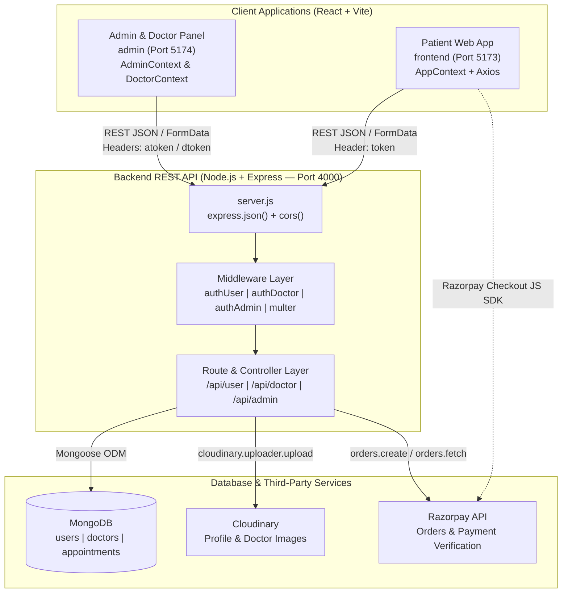
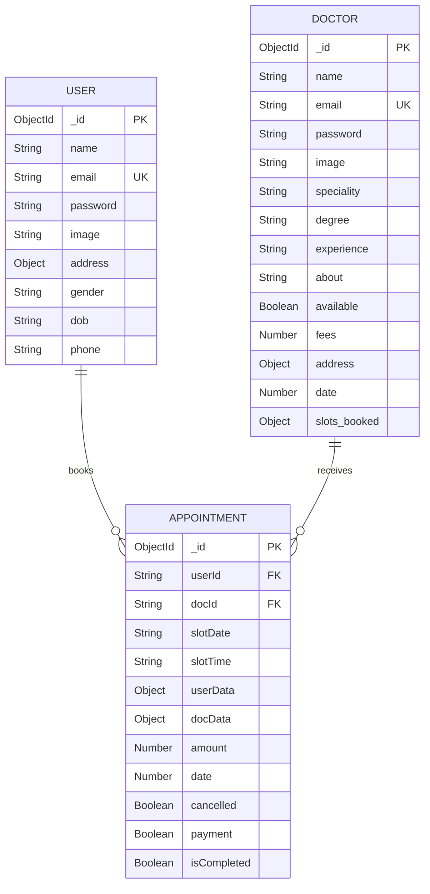

# Prescripto — Doctor Appointment Booking Web Application


A full-stack MERN healthcare appointment booking and clinic management platform connecting **patients**, **doctors**, and **administrators** across two dedicated React web applications backed by a single Express and MongoDB REST API.

---

## Table of Contents

- [Project Overview](#project-overview)
- [Key Features](#key-features)
- [User Roles and Functionalities](#user-roles-and-functionalities)
- [Technology Stack](#technology-stack)
- [Application Screenshots](#application-screenshots)
- [Project Architecture](#project-architecture)
- [Project Folder Structure](#project-folder-structure)
- [Installation and Setup](#installation-and-setup)
- [Environment Variables](#environment-variables)
- [API Documentation](#api-documentation)
- [Authentication and Authorization](#authentication-and-authorization)
- [Database Design](#database-design)
- [Deployment Information](#deployment-information)
- [Future Improvements](#future-improvements)
- [Learning Outcomes](#learning-outcomes)
- [Author](#author)
- [License](#license)

---

## Project Overview

**Prescripto** digitizes the end-to-end doctor appointment lifecycle. Patients can browse verified doctors by medical speciality, inspect live slot availability across a 7-day window, book 30-minute consultation slots, complete online payments through Razorpay, and manage their profile and appointment history.

Alongside the patient-facing storefront (`frontend`), the project includes a unified **Admin & Doctor Management Panel** (`admin`). Administrators onboard doctors with profile imagery hosted on Cloudinary, toggle availability, monitor platform metrics, and oversee bookings. Doctors sign in to the same portal using role-scoped credentials to review their schedule, mark consultations as completed or cancelled, track earnings, and update their consultation fees, clinic address, and availability status.

---

## Key Features

- **Multi-Role Platform**: Dedicated workflows and JWT-protected routes for Patients, Doctors, and Administrators.
- **Speciality-Based Doctor Discovery**: Filter doctors across six specialities (*General physician*, *Gynecologist*, *Dermatologist*, *Pediatricians*, *Neurologist*, and *Gastroenterologist*) with live availability indicators and related-doctor suggestions.
- **Real-Time Slot Management**: Generates 30-minute consultation slots (10:00 AM – 9:00 PM) for the next 7 days while hiding already-booked slots; prevents double-booking on the server and automatically releases slots upon patient or admin cancellation.
- **Online Payments via Razorpay**: Server-side order creation (`razorpay.orders.create`) paired with the Razorpay Checkout SDK on the client and server-side order status verification (`razorpay.orders.fetch`).
- **Cloud Media Uploads**: Handles profile picture uploads for patients and onboarding photos for doctors via Multer and Cloudinary.
- **Role-Based Dashboards**:
  - **Admin Dashboard**: Displays total doctors, total appointments, registered patients, and the 5 most recent bookings with cancellation controls.
  - **Doctor Dashboard**: Displays total earnings (from completed or paid appointments), appointment count, patient count, and recent bookings with completion and cancellation actions.
- **Responsive UI & Feedback**: Built with Tailwind CSS and `react-toastify` for clear state feedback across desktop and mobile viewports.

---

## User Roles and Functionalities

| Role | Portal | Capabilities |
| :--- | :--- | :--- |
| **Patient (User)** | `frontend` (`:5173`) | Register and log in; browse all doctors or filter by speciality; view doctor profiles, fees, and bio; book available 30-minute slots across 7 days; pay online with Razorpay; view appointment status (`Paid`, `Completed`, `Cancelled`); cancel upcoming appointments; edit personal details and upload a profile photo. |
| **Doctor** | `admin` (`:5174`) | Log in via the Doctor mode on the portal; view earnings, appointments, and recent bookings on the dashboard; view full appointment list with payment mode (`Online` / `CASH`) and patient age; mark appointments as completed or cancelled; update consultation fees, clinic address, and availability toggle. |
| **Administrator** | `admin` (`:5174`) | Log in via the Admin mode using environment-configured credentials; view platform metrics (doctors, appointments, patients) and latest bookings; onboard new doctors with profile photos; browse all doctors and toggle availability; review all platform appointments and cancel bookings. |

---

## Technology Stack

### Frontend (`frontend` & `admin`)

| Technology | Version | Purpose |
| :--- | :--- | :--- |
| **React** | `^19.0.0` | Component-based UI for Patient and Admin/Doctor SPAs |
| **Vite** | `^6.4.0` | Development server and production bundler |
| **React Router DOM** | `^7.2.0` / `^7.4.1` | Client-side routing and URL parameter handling |
| **Axios** | `^1.8.1` / `^1.8.4` | HTTP client for REST API communication |
| **Tailwind CSS** | `^3.4.17` | Utility-first responsive styling (`@tailwindcss/vite ^4.0.9` also present in `frontend`) |
| **React Toastify** | `^11.0.5` | Toast notifications for API success/error states |
| **React Context API** | Built-in | Global state (`AppContext`, `AdminContext`, `DoctorContext`) |

### Backend (`backend`)

| Technology | Version | Purpose |
| :--- | :--- | :--- |
| **Node.js (ES Modules)** | — | Server runtime (`"type": "module"`) |
| **Express** | `^4.21.2` | REST API routing and middleware pipeline |
| **Mongoose** | `^8.19.1` | MongoDB ODM, schema modeling, and queries |
| **Multer** | `^1.4.5-lts.2` | `multipart/form-data` handling for image uploads |
| **Validator** | `^13.15.15` | Email format validation during registration and doctor onboarding |
| **CORS** | `^2.8.5` | Cross-origin resource sharing between SPAs and API |
| **dotenv** | `^16.6.1` | Environment variable loading |
| **Nodemon** | `^3.1.10` | Development auto-reload server |

### Database

- **MongoDB** (accessed via Mongoose `^8.19.1`) storing `user`, `doctor`, and `appointment` collections.

### Authentication and Security

- **JSON Web Tokens (`jsonwebtoken ^9.0.2`)**: Role-isolated tokens signed with `JWT_SECRET` and verified via dedicated Express middlewares (`authUser`, `authDoctor`, `authAdmin`).
- **Password Hashing (`bcrypt ^5.1.1`)**: Salted password hashing (10 salt rounds) for patient and doctor credentials.
- **Input Validation**: Required field checks, email validation (`validator.isEmail`), and minimum password length enforcement (6+ characters for patients, 8+ characters for doctors).

### Third-Party Integrations

- **Cloudinary (`cloudinary ^2.7.0`)**: Cloud image storage for doctor onboarding portraits and patient profile pictures.
- **Razorpay (`razorpay ^2.9.6` + Checkout v1 script)**: Order creation, checkout modal, and payment status verification.

---

## Application Screenshots

> **Note:** No application screenshots are currently stored in the repository. Add screenshots to a `docs/screenshots/` directory using the filenames below to render them automatically on GitHub.

| View | Preview |
| :--- | :--- |
| **Patient Home & Specialities** | `` *(Placeholder — add screenshot)* |
| **Doctor Listing & Slot Booking** | `` *(Placeholder — add screenshot)* |
| **My Appointments & Razorpay Checkout** | `` *(Placeholder — add screenshot)* |
| **Admin Dashboard & Doctor Onboarding** | `` *(Placeholder — add screenshot)* |
| **Doctor Dashboard & Appointments** | `` *(Placeholder — add screenshot)* |

**Instructions for adding screenshots:**
1. Create a `docs/screenshots/` folder in the project root.
2. Run the backend, patient frontend, and admin panel locally and capture `1280x720` PNG screenshots of each screen.
3. Save the files using the filenames above and replace the code-formatted placeholders with standard Markdown image tags (``).

---

## Project Architecture

Prescripto follows a **decoupled client-server architecture** where two independent Vite + React single-page applications communicate with a shared Node.js/Express REST API over HTTP/JSON (and `multipart/form-data` for file uploads).

- **State & Networking**: Each React client uses Context providers (`AppContext`, `AdminContext`, `DoctorContext`) to persist JWT tokens in `localStorage` and attach them to Axios request headers (`token`, `atoken`, `dtoken`).
- **API Layer**: `backend/server.js` initializes MongoDB and Cloudinary, applies JSON parsing and CORS middleware, and mounts three modular routers: `/api/user`, `/api/doctor`, and `/api/admin`.
- **Persistence & External Services**: Controllers interact with Mongoose models for data persistence, Multer + Cloudinary for image uploads, and the Razorpay Node SDK for order creation and verification.



---

## Project Folder Structure

```text
.
├── backend/                          # Node.js + Express REST API
│   ├── config/
│   │   ├── cloudinary.js             # Cloudinary SDK configuration
│   │   └── mongodb.js                # Mongoose connection setup
│   ├── controllers/
│   │   ├── adminController.js        # Admin auth, doctor creation, appointments, dashboard
│   │   ├── doctorController.js       # Doctor auth, availability, appointments, profile, dashboard
│   │   └── userController.js         # Patient auth, profile, booking, cancellation, Razorpay
│   ├── middlewares/
│   │   ├── authAdmin.js              # Verifies admin JWT (`atoken` header)
│   │   ├── authDoctor.js             # Verifies doctor JWT (`dtoken` header) & sets `req.body.docId`
│   │   ├── authUser.js               # Verifies patient JWT (`token` header) & sets `req.body.userId`
│   │   └── multer.js                 # Disk storage middleware for image uploads
│   ├── models/
│   │   ├── appointmentModel.js       # Appointment schema (bookings, payment & status flags)
│   │   ├── doctorModel.js            # Doctor schema (profile, fees, availability, slots_booked)
│   │   └── userModel.js              # Patient schema (profile, credentials, default avatar)
│   ├── routes/
│   │   ├── adminRoute.js             # /api/admin endpoints
│   │   ├── doctorRoute.js            # /api/doctor endpoints
│   │   └── userRoute.js              # /api/user endpoints
│   ├── package.json
│   └── server.js                     # Express app entry point
│
├── frontend/                         # Patient-facing React + Vite application
│   ├── index.html                    # Entry HTML (includes Razorpay Checkout script)
│   ├── src/
│   │   ├── assets/                   # Logos, speciality icons, doctor portraits, static assets
│   │   ├── components/
│   │   │   ├── Banner.jsx            # Account creation call-to-action banner
│   │   │   ├── Footer.jsx            # Site footer and contact details
│   │   │   ├── Header.jsx            # Landing page hero section
│   │   │   ├── Menu.jsx              # Speciality filter navigation strip
│   │   │   ├── Navbar.jsx            # Responsive navigation bar & user dropdown
│   │   │   ├── RelatedDoctors.jsx    # Same-speciality doctor recommendations
│   │   │   └── TopDoctors.jsx        # Featured doctors grid on Home page
│   │   ├── context/
│   │   │   └── AppContext.jsx        # Global doctors list, user profile, auth token & currency
│   │   ├── pages/
│   │   │   ├── About.jsx             # Platform overview and value propositions
│   │   │   ├── Appointment.jsx       # Doctor detail view & 7-day slot booking UI
│   │   │   ├── Contact.jsx           # Office location and contact details
│   │   │   ├── Doctors.jsx           # Filterable doctor directory by speciality
│   │   │   ├── Home.jsx              # Landing page composition
│   │   │   ├── Login.jsx             # Patient sign-up and login page
│   │   │   ├── MyAppointments.jsx    # Patient bookings list, Razorpay payment & cancellation
│   │   │   └── MyProfile.jsx         # Patient profile editor with Cloudinary photo upload
│   │   ├── App.jsx                   # Patient route definitions
│   │   └── main.jsx                  # React entry point with BrowserRouter & AppContextProvider
│   ├── tailwind.config.js
│   ├── vite.config.js                # Configured on port 5173
│   └── package.json
│
├── admin/                            # Admin & Doctor Portal (React + Vite)
│   ├── index.html
│   ├── src/
│   │   ├── assets/                   # Portal icons, logos, and assets map
│   │   ├── components/
│   │   │   ├── Navbar.jsx            # Portal header with active role badge & logout
│   │   │   └── Sidebar.jsx           # Conditional sidebar navigation for Admin or Doctor
│   │   ├── context/
│   │   │   ├── AdminContext.jsx      # Admin token, doctors, appointments & dashboard state
│   │   │   ├── AppContext.jsx        # Shared helpers (age calculation, date formatting, currency)
│   │   │   └── DoctorContext.jsx     # Doctor token, appointments, dashboard & profile state
│   │   ├── pages/
│   │   │   ├── Admin/
│   │   │   │   ├── AddDoctor.jsx     # Doctor onboarding form with image upload
│   │   │   │   ├── AllApointments.jsx# Platform-wide appointment table & cancellation
│   │   │   │   ├── Dashboard.jsx     # Admin KPIs and latest bookings
│   │   │   │   └── DoctorsList.jsx   # Doctor directory with availability toggle
│   │   │   ├── Doctor/
│   │   │   │   ├── DoctorAppointments.jsx # Doctor schedule with complete/cancel actions
│   │   │   │   ├── DoctorDashboard.jsx    # Doctor earnings, stats & latest bookings
│   │   │   │   └── DoctorProfile.jsx      # Doctor profile view & inline fee/address editor
│   │   │   └── Login.jsx             # Unified Admin / Doctor role-switching login page
│   │   ├── App.jsx                   # Role-gated portal routing
│   │   └── main.jsx                  # React entry point with all context providers
│   ├── tailwind.config.js
│   ├── vite.config.js                # Configured on port 5174
│   └── package.json
│
├── .gitignore
└── README.md
```

---

## Installation and Setup

### Prerequisites

- **Node.js** (v18+ recommended) and **npm**
- **MongoDB** database (MongoDB Atlas or local MongoDB instance)
- **Cloudinary** account (for doctor and user profile images)
- **Razorpay** account (test or live API keys for online payments)

### 1. Clone the Repository

```bash
git clone https://github.com/<your-username>/<your-repo-name>.git
cd <your-repo-name>
```

### 2. Install Dependencies

Each package manages its own dependencies. Install all three in separate steps:

```bash
# Install backend dependencies
cd backend
npm install

# Install patient frontend dependencies
cd ../frontend
npm install

# Install admin & doctor portal dependencies
cd ../admin
npm install
```

### 3. Configure Environment Variables

Create `.env` files inside `backend/`, `frontend/`, and `admin/` using the templates in the [Environment Variables](#environment-variables) section below.

### 4. Run the Application Locally

Start each service in its own terminal window:

```bash
# Terminal 1 — Start Backend API (http://localhost:4000)
cd backend
npm run server
# Or for non-watch mode: npm start
```

```bash
# Terminal 2 — Start Patient Frontend (http://localhost:5173)
cd frontend
npm run dev
```

```bash
# Terminal 3 — Start Admin & Doctor Panel (http://localhost:5174)
cd admin
npm run dev
```

Verify the backend is running by visiting `http://localhost:4000/` — it responds with `API WORKING`.

---

## Environment Variables

All `.env` files are git-ignored by the root `.gitignore`. Do not commit real credentials to version control.

### Backend (`backend/.env`)

```env
PORT=4000
MONGODB_URI=mongodb+srv://<username>:<password>@<cluster-url>/<database-name>
JWT_SECRET=your_strong_jwt_secret_key

# Admin Portal Credentials
ADMIN_EMAIL=admin@example.com
ADMIN_PASSWORD=your_admin_password

# Cloudinary Configuration
CLOUDINARY_NAME=your_cloudinary_cloud_name
CLOUDINARY_API_KEY=your_cloudinary_api_key
CLOUDINARY_SECRET_KEY=your_cloudinary_secret_key

# Razorpay Configuration
RAZORPAY_KEY_ID=rzp_test_your_key_id
RAZORPAY_KEY_SECRET=your_razorpay_key_secret
CURRENCY=INR
```

### Patient Frontend (`frontend/.env`)

```env
VITE_BACKEND_URL=http://localhost:4000
VITE_RAZORPAY_KEY_ID=rzp_test_your_key_id
```

### Admin & Doctor Panel (`admin/.env`)

```env
VITE_BACKEND_URL=http://localhost:4000
```

---

## API Documentation

Base URL (local): `http://localhost:4000`

All endpoints return JSON payloads following the structure `{ "success": boolean, "message"?: string, ...data }`.

### Health Check

| Method | Endpoint | Auth | Description |
| :--- | :--- | :--- | :--- |
| `GET` | `/` | Public | Returns `API WORKING` to verify server status. |

### User (Patient) Endpoints — `/api/user`

| Method | Endpoint | Auth Header | Description |
| :--- | :--- | :--- | :--- |
| `POST` | `/api/user/register` | Public | Registers a patient (`name`, `email`, `password` min 6 chars) and returns a JWT (`1d` expiry). |
| `POST` | `/api/user/login` | Public | Authenticates patient credentials and returns a JWT. |
| `GET` | `/api/user/get-profile` | `token` | Fetches authenticated patient profile (excluding password). |
| `POST` | `/api/user/update-profile` | `token` | Updates `name`, `phone`, `address` (JSON string), `dob`, `gender`, and optional `image` file (`multipart/form-data`). |
| `POST` | `/api/user/book-appointment` | `token` | Books a slot (`docId`, `slotDate`, `slotTime`) if doctor and slot are available; updates `slots_booked`. |
| `GET` | `/api/user/appointments` | `token` | Returns all appointments belonging to the authenticated patient. |
| `POST` | `/api/user/cancel-appointment` | `token` | Verifies ownership, cancels `appointmentId`, and releases the booked slot on the doctor document. |
| `POST` | `/api/user/payment-razorpay` | `token` | Creates a Razorpay order for `appointmentId` (`amount * 100`, `CURRENCY`). |
| `POST` | `/api/user/verifyRazorpay` | `token` | Verifies `razorpay_order_id` status via Razorpay API and sets `payment: true` when paid. |

### Doctor Endpoints — `/api/doctor`

| Method | Endpoint | Auth Header | Description |
| :--- | :--- | :--- | :--- |
| `GET` | `/api/doctor/list` | Public | Lists all doctors (excluding `password` and `email`) for the patient directory. |
| `POST` | `/api/doctor/login` | Public | Authenticates doctor credentials and returns a JWT (`{ id: doctor._id }`). |
| `GET` | `/api/doctor/appointments` | `dtoken` | Retrieves all appointments assigned to the authenticated doctor. |
| `POST` | `/api/doctor/complete-appointment` | `dtoken` | Verifies doctor ownership and marks `appointmentId` as `isCompleted: true`. |
| `POST` | `/api/doctor/cancel-appointment` | `dtoken` | Verifies doctor ownership and marks `appointmentId` as `cancelled: true`. |
| `GET` | `/api/doctor/dashboard` | `dtoken` | Returns `earnings`, total `appointments`, `patients` count, and the 5 `latestAppointments`. |
| `GET` | `/api/doctor/profile` | `dtoken` | Fetches the authenticated doctor's profile (excluding password). |
| `POST` | `/api/doctor/update-profile` | `dtoken` | Updates doctor `fees`, `address`, and `available` status. |

### Admin Endpoints — `/api/admin`

| Method | Endpoint | Auth Header | Description |
| :--- | :--- | :--- | :--- |
| `POST` | `/api/admin/login` | Public | Validates credentials against `ADMIN_EMAIL` / `ADMIN_PASSWORD` and returns a signed JWT. |
| `POST` | `/api/admin/add-doctor` | `atoken` | Creates a new doctor (`multipart/form-data` with `image` file, credentials, speciality, degree, experience, fees, address, about). |
| `POST` | `/api/admin/all-doctors` | `atoken` | Returns all doctors (excluding `password`). |
| `POST` | `/api/admin/change-availability` | `atoken` | Toggles `available` boolean status for `docId`. |
| `GET` | `/api/admin/appointments` | `atoken` | Returns all appointments across the platform. |
| `POST` | `/api/admin/cancel-appointment` | `atoken` | Cancels `appointmentId` and releases the corresponding slot in `doctor.slots_booked`. |
| `GET` | `/api/admin/dashboard` | `atoken` | Returns total `doctors`, `appointments`, `patients`, and the 5 `latestAppointments`. |

---

## Authentication and Authorization

Prescripto isolates permissions across three custom Express middlewares located in `backend/middlewares/`:

1. **Patient Authentication (`authUser.js`)**:
   - Reads the `token` header (stored in `localStorage` under `token` on `frontend`).
   - Verifies the JWT with `process.env.JWT_SECRET` and injects `req.body.userId = token_decode.id` for downstream controllers.
   - Passwords are hashed using `bcrypt` with 10 salt rounds on registration.
2. **Doctor Authentication (`authDoctor.js`)**:
   - Reads the `dtoken` header (stored in `localStorage` under `dToken` on `admin`).
   - Verifies the JWT and injects `req.body.docId = token_decode.id`.
   - Appointment completion and cancellation controllers explicitly assert `appointmentData.docId === docId` before mutating records.
3. **Admin Authentication (`authAdmin.js`)**:
   - Reads the `atoken` header (stored in `localStorage` under `aToken` on `admin`).
   - Verifies the JWT payload matches `process.env.ADMIN_EMAIL + process.env.ADMIN_PASSWORD`.

> **Note:** HTTP header names are lowercased by Express (`req.headers.token`, `req.headers.dtoken`, `req.headers.atoken`), so clients sending `{ headers: { aToken } }` or `{ headers: { dToken } }` are matched seamlessly by the middleware.

---

## Database Design

Prescripto uses three Mongoose schemas defined in `backend/models/`.



### Schema Highlights & Modeling Decisions

- **`userModel.js` (`user`)**: Enforces unique `email` and provides sensible defaults for `address` (`{ line1: '', line2: '' }`), `gender` (`"Not Selected"`), `dob` (`"Not Selected"`), `phone` (`"0000000000"`), and a default base64 avatar `image`.
- **`doctorModel.js` (`doctor`)**: Uses `{ minimize: false }` so the `slots_booked` object (`{ "D_M_YYYY": ["10:00 AM", ...] }`) persists even when empty. This map enables fast slot-conflict checks during booking without querying the `appointments` collection for every slot render.
- **`appointmentModel.js` (`appointment`)**: Stores `userId` and `docId` references alongside embedded `userData` and `docData` snapshots (with passwords and `slots_booked` stripped) so historical bookings preserve doctor details, fees (`amount`), and patient details at the time of booking while reducing join overhead on listing pages.

---

## Deployment Information

Because the repository is organized into three independent applications, each component can be built and deployed separately:

1. **Backend (`backend/`)**:
   - Deploy to a Node.js host (such as Render, Railway, or a VPS).
   - Start command: `npm start` (`node server.js`).
   - Configure all backend environment variables (`MONGODB_URI`, `JWT_SECRET`, `ADMIN_EMAIL`, `ADMIN_PASSWORD`, Cloudinary credentials, Razorpay credentials, `CURRENCY`, and `PORT`).
   - Note: `backend/server.js` sets DNS resolvers to `1.1.1.1` and `8.8.8.8` via `dns.setServers` to ensure reliable MongoDB Atlas SRV lookups.
2. **Patient Frontend (`frontend/`)**:
   - Build command: `npm run build` (outputs static assets to `frontend/dist/`).
   - Deploy to static hosting (such as Vercel or Netlify) with SPA fallback rewrites to `index.html`.
   - Set `VITE_BACKEND_URL` to your deployed backend URL and `VITE_RAZORPAY_KEY_ID` to your Razorpay public key.
3. **Admin & Doctor Portal (`admin/`)**:
   - Build command: `npm run build` (outputs static assets to `admin/dist/`).
   - Deploy as a separate static site with SPA fallback rewrites to `index.html`.
   - Set `VITE_BACKEND_URL` to your deployed backend URL.

---

## Future Improvements

The following enhancements are **not currently implemented** and represent recommended next steps for hardening and scaling the platform:

- **Payment Security**: Add Razorpay HMAC-SHA256 signature verification (`razorpay_signature`) and webhook handling alongside `orders.fetch`.
- **Authentication Hardening**: Enforce consistent JWT expiration across login endpoints, introduce refresh tokens, store admin credentials hashed in the database rather than plain-text env comparison, and use `Authorization: Bearer <token>` headers.
- **Bug & Edge-Case Fixes**:
  - Release `slots_booked` when a doctor cancels an appointment (currently handled on patient and admin cancellations).
  - Fix unique patient aggregation in `doctorDashboard` (`!patients.includes(item.userId)`).
  - Normalize route casing in `DoctorProfile.jsx` (`/api/doctor/update-profile`) and speciality field/whitespace consistency (`speciality` vs. `specialty` in doctor cards).
- **Search, Pagination & Filtering**: Add doctor search by name/location and server-side pagination for appointments and doctor directories.
- **Notifications & Reminders**: Integrate transactional email/SMS confirmations and appointment reminders.
- **Automated Testing**: Add unit and integration tests (e.g., Vitest / Supertest) for booking conflict logic, auth middlewares, and payment flows.

---

## Learning Outcomes

Building Prescripto demonstrates practical experience in:

- Architecting a **multi-client full-stack MERN application** with shared backend services and isolated role portals.
- Implementing **role-based authentication and authorization** with JWT, `bcrypt`, and custom Express middlewares.
- Designing **NoSQL schemas in MongoDB/Mongoose** combining reference IDs, embedded read snapshots, and structured slot availability maps.
- Integrating **third-party cloud services** end-to-end: Multer + Cloudinary for media pipelines and Razorpay for server-verified online payments.
- Managing **shared client state** in React 19 using Context API, React Router v7, and Axios intercept-style header patterns.

---

## Author

- **Name:** `[Your Full Name]`
- **GitHub:** `[https://github.com/your-username]`
- **LinkedIn:** `[https://linkedin.com/in/your-profile]`
- **Portfolio:** `[https://your-portfolio-url.com]`
- **Email:** `[your-email@example.com]`

---

## License

No root `LICENSE` file has been specified for this repository yet. *(Note: `backend/package.json` lists `"license": "ISC"`, while `frontend` and `admin` do not specify a license.)* Add a root `LICENSE` file (for example, MIT or ISC) before distributing or open-sourcing this project.
